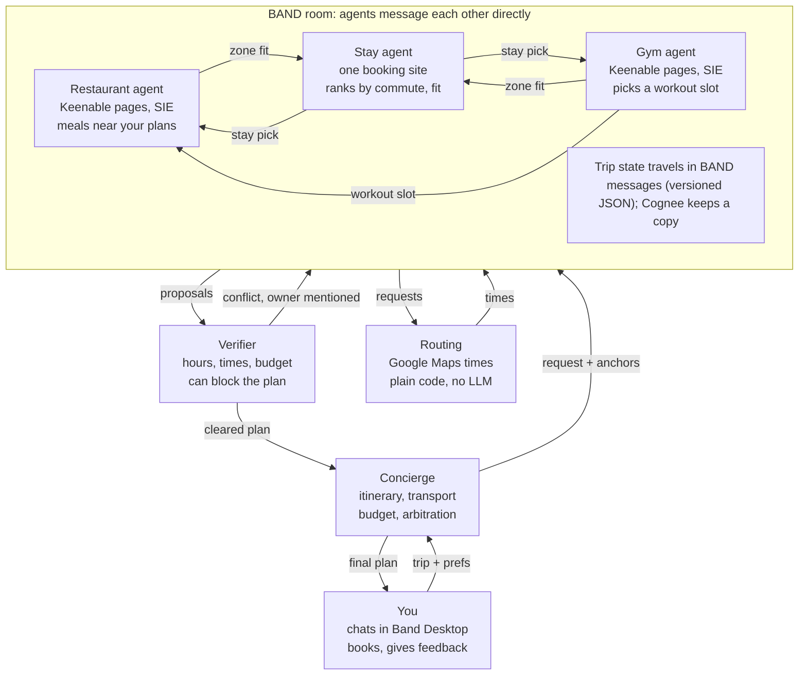

# Plan My Stay: Hive Mind Hackathon Plan

As of 14 Nov 2026

Plan My Stay is a team of agents that plans a work trip around your meetings and remembers how you like to travel.

## What we're building

You give it a city, dates, a total budget for the stay and transport, and your meetings (address and time). Three specialist agents find a stay, restaurants and a gym, and they message each other while they work. You get one itinerary and book it yourself; the agents never pay.

The agents also remember you and get better with use. Dietary needs, cuisines, gym type, preferred workout times and stay preferences go into one shared profile, so the next trip starts with them already known. An optional lesson writer (an extension) turns each trip into plain-text lessons that shape each agent's next search.

Why the agents can't work alone:

- Where you sleep decides which gyms and restaurants are walkable, and which ones exist should decide where you sleep.
- A workout slot decides when and where dinner can happen.
- What one agent learns about you, such as an early start, changes what the others pick.

v1 assumptions, all editable:

- One city, one stay, one itinerary. The stay runs from Tuesday check-in to Thursday check-out (two nights), and a meeting before check-in doesn't constrain where it is.
- The budget is one $1,000 total for the stay plus transport. For now only the stay price counts against it, because transport cost isn't calculated yet. The Stay agent gets the budget and returns no stay priced above it. Food and gym prices are shown but not budgeted.
- Transport means the trips between the stay and the meetings and between meetings. The Routing seat gives travel times for walking, transit and driving, and the Concierge proposes the best option for each trip by time.
- Stay prices are totals including fees and taxes.
- If nothing fits the budget, the Concierge widens the zone or the budget and says so on screen.

Demo trip (New York), Tue 17 Nov to Thu 19 Nov. Each meeting lasts one hour.

| Meeting | Address | When |
| --- | --- | --- |
| A | 199 Water St, New York, NY 10038 | Tue 17 Nov, 11:00 to 12:00 |
| B | 368 9th Ave, New York, NY 10001 | Tue 17 Nov, 16:00 to 17:00 |
| C | 524 Broadway, New York, NY 10012 | Wed 18 Nov, 10:00 to 11:00 |

All three are in Manhattan, so walking and transit will compete with driving on every trip. Tuesday has a four-hour gap between A and B for lunch and a workout, and Wednesday is free after 11:00.

The stay starts on Tuesday, so A comes before check-in. Assuming the traveler arrives on Tuesday and goes straight to A, A doesn't constrain the stay: its commute score uses B to the stay on Tuesday evening and the stay to C on Wednesday. For the same reason, Tuesday's workout falls in the gap between A and B or after B, not near the stay.

Demo user (invented values for the demo; real preferences replace them later):

- Diet: vegetarian
- Cuisines: Mediterranean and Indian
- Gym: HIIT, early morning (about 07:00)
- Stay: quiet street and a private bathroom
- Budget: $1,000 total for the stay plus transport

## What judges score

Judges ask one question: would you use it tomorrow? Each build choice maps to a rubric line.

| Rubric line | What we build | Proof on stage |
| --- | --- | --- |
| Production-ready | No separate UI: a user talks to the Concierge in a BAND room, and each agent starts with one command. A README, no hardcoded secrets | A teammate joins the room and plans a trip cold |
| Shared memory that learns | Cognee stores each user's preferences, a copy of the trip state, shared city facts and every agent's traces, and each agent recalls what applies before it searches | A preference one agent learns changes another agent's picks in the same run, and run 2 starts from remembered preferences |
| Small-model swarm | Keenable finds the pages, Superlinked SIE reads and ranks them with small models, plain code does the checks, and a frontier model only arbitrates and writes the final itinerary | The share of calls by model tier (the cost ledger is an extension) |
| Multiplayer agents | Extension: another team's agent joins the room over BAND | A live handoff |
| Earns or saves real money | Extension: this swarm's cost against a traditional all-LLM agent on the same trips | A cost table |

The organizers' slides list prizes of $750, $500 and $250, plus a $500 bonus challenge at 4:00 PM. The Luma page says $2k plus credits and different times, so confirm with an organizer. We plan to the slides.

## Agent seats and how they talk

BAND's delete test: if the app still works with the room removed, BAND wasn't essential. Here the three specialists message each other directly in the room, and the Concierge only checks the budget, proposes transport and arbitrates. The Concierge is a seat that reacts to mentions, not a script that calls agents in order.



Shared: Cognee memory, Keenable, Superlinked SIE. Google Maps sits behind the Routing seat.

Highlighted lines are the Verifier's decisions: a conflict goes to the agent that owns it, and a cleared plan goes to the Concierge.

| Seat | Job | Owner | Model tier |
| --- | --- | --- | --- |
| Concierge | Talks to the user in the BAND room, holds the private itinerary, proposes the best transport mode for each trip by travel time, checks the top stay against the budget, arbitrates ties and conflicts between the other agents and explains the trade-off to the user (it gates and arbitrates; it does not rank stays), writes the final itinerary | Mario | Frontier, for arbitration and the final write-up only |
| Stay agent | Finds stays on one site (Airbnb worked best in the 14 Nov test), one map box per zone, drops any stay priced above the budget, then ranks the rest by commute time and the other agents' zone fit with a plain-code score (see How the Stay agent ranks stays) | Rohan | Keenable pages read by a small model on SIE (Qwen3.5-4B); the ranking is plain code, no LLM |
| Restaurant agent | Finds meals near the meetings and the stay, inside the time windows, matching dietary preferences | Jwalin | Keenable pages read by a small model on SIE (Qwen3.5-4B); SIE reranker |
| Gym agent | Finds gyms near the stay (or near the meetings before check-in), picks a workout slot, matches gym preferences | Prathik | Keenable pages read by a small model on SIE (Qwen3.5-4B); SIE reranker |
| Verifier | Checks opening hours, travel time between events and the stay price against the budget; can block the plan | Mario | Plain code checks, no LLM |
| Routing | Answers route requests: geocodes addresses and returns travel times for walking, transit and driving at a given time; holds the Google Maps key and caches results | Mario | Plain code, no LLM |

Routing (Google Maps) is a seat: any seat asks it for travel times by message. What the agents tell each other (each is a JSON message type, defined under How agents share information):

| Message | Who to whom | What it changes |
| --- | --- | --- |
| Zone fit: matching restaurants and gyms within a short walk, per zone, with which of the top ones are open at the meal windows or can host the preferred workout slot | Restaurant and Gym to Stay | The Stay agent re-ranks stays by commute plus zone fit |
| Stay pick: the shortlisted or chosen stay's location and commute times | Stay to Restaurant and Gym | Both search around the stay for mornings and evenings |
| Workout slot: day, start, end and place | Gym to Restaurant | The Restaurant agent sets its dinner window and area around the workout |
| Stay shortlist: a ranked list of stays within the budget, with total price, commute times and the factor that decided each placement | Stay to Concierge | The Concierge adds the best transport mode by time for each trip, checks the top stay against the budget, arbitrates ties and conflicts, and asks for cheaper options if it's over |
| Preference learned: key, value and evidence | Any agent to its peers, then to the profile | Peers use it in the same run; Cognee keeps it for later runs |
| Conflict: which rule broke and on which item | Verifier to the owning agent | The owner revises and posts again |
| Route request: origin, destination and time | Any seat to Routing | Routing replies with travel times for walking, transit and driving |

BAND counts a seat as essential when at least one of these holds:

| Condition | Where it happens in a run |
| --- | --- |
| Dependent handoff | Zone fit changes the Stay agent's ranking, the workout slot changes the Restaurant agent's window, and a conflict changes the owner's next search. |
| Blockable verdict | The Concierge delivers only after the Verifier clears the plan. |
| Roster at runtime | The Concierge recruits only the agents the request needs, so no Gym agent if the user skips workouts. A partner team's agent can join too (see Extensions). |
| Enforced boundary | Agents see anchors and time windows, never meeting names or attendees. A partner team's agent joins through a contact request both sides approve (see Extensions). |

**How the Stay agent ranks stays**

The Stay agent ranks the stays, and the Concierge only gates and arbitrates. The Stay agent owns the stay data (price, zone, and commute times from the Routing seat) and receives the `zone_fit` messages from the Restaurant and Gym agents. The Concierge sees neither the listings nor the page-level evidence, and if it did the scoring, every `zone_fit` would pass through a frontier model, which defeats the small-model design. The score is plain code, so it is cheap and testable.

1. **Hard filters first.** Drop any stay priced above the $1,000 budget, and any stay outside a workable commute of the meetings after check-in. Meetings before check-in don't count (`counts_for_stay` is false).
2. **Then a weighted score per zone.**
   - Commute: the average and the worst travel time to the anchors that count. This has the heaviest weight, because the meetings are the fixed points.
   - Gym fit: whether there is a gym of the user's type near the stay, and whether the preferred workout slot (about 07:00) can work from there.
   - Restaurant fit: how many options match the diet within a short walk, and how many of the top ones are open at the meal windows.
   - Stay preferences (quiet street, private bathroom) break ties.
3. **Rank by the score, not by raw counts.** Counts reward dense, noisy neighborhoods, so cap the credit for extra restaurants after about five.
4. **Return a ranked shortlist, not one pick,** and say which factor decided each placement (`rank` and `deciding_factor` on each stay in `stay_shortlist`). That gives the Concierge something to arbitrate.

The Concierge checks the top stay against the budget, resolves ties and conflicts (for example, the best gym zone is a 40-minute commute while the best commute zone has no gym), and explains the trade-off to the user. Only the commute weight is set so far; the other weights, the workable-commute limit and the restaurant cap are first guesses to tune in the first full run.

Each seat runs as its own process and acts only when mentioned. Build each agent as a plain function that takes a parsed message and returns the messages to send (`handle(message) -> messages`), with a thin BAND wrapper that does the parsing and posting, so it can be tested without BAND.

**Architecture for the Verifier, routing and memory** (agreed on 14 Nov)

- **Verifier: a BAND seat running plain code, no LLM.** BAND's blockable-verdict test needs a separate seat that can stop the plan; a function the Concierge calls would not count. The BAND quickstart shows a model-free agent: a Python LangGraph graph with one non-LLM node that replies through `band_send_message`.
- **Routing: a plain-code BAND seat, not an HTTP service.** Mario runs a Routing seat that wraps Google Maps geocoding and route matrices. Seats ask it for travel times by message, so all traffic goes through BAND and no laptop needs to reach another laptop. It holds the Maps key, caches results and answers in the same message envelope as every other seat. A lookup is a message round trip, so keep lookups to the few a run needs.
- **Trip state: versioned JSON in the BAND messages.** Every message carries `state_version`, and the Concierge raises it on each change. The plain-code Verifier works from this exact state. Cognee keeps a copy for memory only, because its session read returns just the last 20 entries and its recall is text retrieval.
- **Memory: one shared Cognee Cloud account and key, one session per trip.** Cognee scopes session entries to the user, so two users don't share a session, and a shared dataset has to be targeted by its UUID. Three agents wrote to one session at once in a test with no lost entries, so every agent can write to the trip session.
- **Where agents run: each owner's laptop, joined through BAND.** All four teammates are in one BAND room. One shared Cognee key serves all of them and the Routing seat handles travel times, so everyone builds and tests in parallel.

**BAND setup**

- Register each seat at app.band.ai: Concierge, Stay, Restaurant, Gym, Verifier, Routing (Connect remote agent; description of at least 10 characters; avoid names like "Assistant" or "Bot").
- The API key shows once. Keep `agent_config.yaml` and `.env` out of git.
- Python: `uv add "band-sdk[langgraph]"` installs the latest release (9.2.1 on 13 Nov; the quickstart showed 9.1.0). The SDK shipped three major versions in two weeks, so check the changelog if something breaks. Connect with `Agent.from_config("name", adapter=...)`. A plain-code seat such as the Verifier or Routing uses `LangGraphAdapter` with a graph that has one non-LLM node; LLM seats add a model extra such as `[anthropic]`.
- An agent receives only messages that mention it, and it must first be added to the room as a participant.

## Who builds what

Four people, one agent each plus the orchestrator. All three specialists follow the same recipe, Keenable to find pages and SIE to read them, through one page reader that Rohan builds. Restaurant and gym pages should be easier than booking sites, so Jwalin and Prathik should finish their agents first and then take work from Mario.

| Person | Owns | First deliverable |
| --- | --- | --- |
| Rohan | Stay agent (one site for now: Booking.com or Airbnb, whichever the data spike supports) and the shared page reader (Keenable fetch, then SIE extract and score) | A stub that answers a request with a valid proposal message (fixture stays) within about 45 minutes, then a first page reader, then live data |
| Jwalin | Restaurant agent | The same stub, then live results through Rohan's page reader |
| Prathik | Gym agent | The same stub, then live results through Rohan's page reader |
| Mario | Orchestrator: Concierge seat (transport proposal, budget check, arbitration), BAND wiring, shared schema and trip state, Routing seat, Verifier checks, Cognee glue (preferences, a copy of the trip state, city facts, agent traces), secrets and credits (Google billing, Keenable, Cognee, BAND, SIE) | The accounts and keys in the first 30 minutes, then the shared JSON message models with example messages, and one @mention round trip that carries a validated message |

Shared work and who owns it:

| Work | Why it matters | Owner |
| --- | --- | --- |
| Shared page reader: Keenable fetch, then SIE extract and score | All three agents depend on it, so build it once | Rohan |
| Verifier checks | BAND meaningful use and production-readiness | Mario |
| Cognee glue: preferences, a copy of the trip state, city facts, agent traces | Rubric: memory that learns | Mario |
| Secrets and credits: Google billing, Keenable, Cognee, BAND, SIE | Everyone is blocked without them. Keenable's keyless limit is per IP and the venue WiFi probably shares one, so each teammate needs a Keenable key | Mario, in the first 30 minutes; share keys privately and never commit them |
| README and setup notes | Production-ready: a teammate can start every agent cold | Not yet assigned; first free person |
| Rehearse the New York demo trip end to end | A real run beats a polished demo | Mario |
| Cost ledger and lesson writer (extensions) | Rubrics: small-model swarm, and memory that learns | Jwalin or Prathik, once their agents work |

Rohan has the riskiest data path and now the page reader, so the reader has to land early. Until it does, Jwalin and Prathik can use Keenable's fetch with a prompt as a stand-in. Mario owns the most (Concierge, Routing seat, Verifier, Cognee glue), so the cost ledger and the lesson writer are extensions for Jwalin or Prathik. If the team falls behind, cut in this order: the extensions, the next-trip memory demo, then the Gym agent (the Restaurant and Stay agents still show peer messaging). Never cut the Verifier gate or the peer messages.

## How agents share information

Every machine message between the Concierge and the specialists is one JSON object, built and parsed by the same shared code, so no agent ever has to read free text from another. Agree on the message models in the first 30 minutes and keep them in one shared module in the repo.

**The envelope.** Every message has the same outer shape; only `payload` changes with `type`. This example is a request to the Restaurant agent (illustrative values, not real results).

```json
{
  "schema_version": "1.0",
  "type": "request",
  "message_id": "6f1c2a52-6d0e-4c1b-9a53-1f0f6b2a9e10",
  "reply_to": null,
  "trip_id": "nyc-2026-11-17",
  "state_version": 2,
  "from": "concierge",
  "to": ["restaurant"],
  "sent_at": "2026-11-14T16:05:00-05:00",
  "summary": "Find vegetarian dinner options for Tue 17 Nov",
  "payload": {
    "city": "New York, NY",
    "dates": {"check_in": "2026-11-17", "check_out": "2026-11-19"},
    "guests": 1,
    "anchors": [
      {"id": "A", "lat": 40.7066, "lng": -74.0053, "start": "2026-11-17T11:00:00-05:00", "end": "2026-11-17T12:00:00-05:00", "counts_for_stay": false},
      {"id": "B", "lat": 40.7502, "lng": -73.9987, "start": "2026-11-17T16:00:00-05:00", "end": "2026-11-17T17:00:00-05:00", "counts_for_stay": true}
    ],
    "zones": [{"id": "z1", "name": "Chelsea", "bounds": {"ne": {"lat": 40.756, "lng": -73.99}, "sw": {"lat": 40.738, "lng": -74.01}}}],
    "slots": [{"id": "s1", "kind": "dinner", "date": "2026-11-17", "window": {"start": "17:30", "end": "21:00"}}],
    "profile": {"diet": ["vegetarian"], "cuisines": ["Mediterranean", "Indian"]},
    "constraints": {"max_walk_minutes": 15},
    "response_type": "proposal"
  }
}
```

| Field | Meaning |
| --- | --- |
| schema\_version | 1.0. A new major version breaks parsing, so receivers reject an unknown major version |
| type | One of the message types below |
| message\_id | A unique id (UUID) |
| reply\_to | The message\_id this answers, or null |
| trip\_id | The trip, which is also its Cognee session id |
| state\_version | The version of the trip state this message was built on. The Concierge raises it on every change |
| from, to | Seat names: concierge, stay, restaurant, gym, verifier, routing. to is a list |
| sent\_at | ISO 8601 timestamp with an offset |
| summary | One readable line, because people watch the room in Band Desktop |
| payload | The object for this type |

**Message types**

| type | From and to | Payload keys |
| --- | --- | --- |
| request | Concierge to Stay, Restaurant, Gym | city, dates, guests, anchors (id, lat, lng, start, end, counts\_for\_stay), zones, slots, profile, constraints, budget (Stay only: it returns no stay priced above it), roster, round (0 to 2), response\_type |
| proposal | Each specialist to Concierge and Verifier | agent, items, usage |
| zone\_fit | Restaurant and Gym to Stay | zone\_id, counts of matching restaurants and gyms within a short walk, top\_items (each marked open at the meal windows or, for a gym, able to host the preferred workout slot) |
| stay\_shortlist | Stay to Concierge | ranked stays priced within the budget, each with rank, deciding\_factor, stay\_id, zone\_id, total\_price, currency and commute times per anchor |
| stay\_pick | Stay to Restaurant, Gym and Concierge | stay\_id, zone\_id, lat, lng, commute times |
| workout\_slot | Gym to Restaurant and Concierge | date, start, end, place |
| preference\_learned | Any agent to Concierge and the specialists it affects | key, value, evidence |
| conflict | Verifier to the owning agent | rule, item\_id, detail, suggestion |
| verdict | Verifier to Concierge | status (clear, warn or block), plan\_hash (on clear and warn), conflicts |
| error | Any seat to the sender | code, bad\_message\_id, fields |
| route\_request | Any seat to Routing | origin, destination, depart\_at, modes |
| route\_reply | Routing to the requester | travel minutes per mode, or an error |

Each entry in a `proposal`'s `items` carries `item_id`, `slot_id`, `name`, `address`, `location_precision (exact or zone), lat`, `lng`, `when` (date, start, end), `cost` (currency, amount, basis), `fit` (reason and the profile fields used), `hours`, `source` (url and `fetched_at`), `reader` (model and whether it escalated) and a dedupe key. Stays add commute times and the free-cancel deadline when the site shows one.

**Example proposal** (Restaurant to Concierge and Verifier; illustrative values)

```json
{
  "schema_version": "1.0",
  "type": "proposal",
  "message_id": "b7d0c9ae-3f0a-4e43-8d1e-3a4a7b3f5c21",
  "reply_to": "6f1c2a52-6d0e-4c1b-9a53-1f0f6b2a9e10",
  "trip_id": "nyc-2026-11-17",
  "state_version": 2,
  "from": "restaurant",
  "to": ["concierge", "verifier"],
  "sent_at": "2026-11-14T16:07:12-05:00",
  "summary": "1 dinner option for Tue 17 Nov in zone z1",
  "payload": {
    "agent": "restaurant",
    "items": [
      {
        "item_id": "rest-urban-vegan-kitchen",
        "slot_id": "s1",
        "name": "Urban Vegan Kitchen",
        "address": {"street": "265 W 23rd St", "city": "New York", "zip": "10011"},
        "lat": 40.7445,
        "lng": -73.9983,
        "when": {"date": "2026-11-17", "start": "18:30", "end": "19:45"},
        "cost": {"currency": "USD", "amount": null, "basis": "unknown"},
        "fit": {"reason": "Fully vegan menu; open until 22:00 on Tuesday", "profile_fields": ["diet"]},
        "hours": {"Tue": "11:00-22:00"},
        "source": {"url": "https://urbanvegankitchen.com", "fetched_at": "2026-11-14T16:06:40-05:00"},
        "reader": {"model": "Qwen/Qwen3.5-4B", "escalated": false},
        "dedupe_key": "urban-vegan-kitchen|10011"
      }
    ],
    "usage": {"calls": 3, "credits": 118}
  }
}
```

**Rules that keep every message parseable**

- **One object, nothing else.** A machine message's body is exactly one JSON object: no prose, no code fence, no trailing text. The shared parser first strips what BAND adds (a leading "\[Sender\]: " prefix in some adapters, then leading @handles) and then calls `json.loads`.
- **One shared module.** Define the message models once, for example as Pydantic classes that export JSON Schema. Every agent sends with `build_message(...)` and receives with `parse_message(text)`; nobody writes or reads the JSON by hand.
- **Code builds the envelope, not an LLM.** The Concierge's model fills only the payload fields. Code adds `message_id`, `from`, `sent_at` and the rest, serializes the object and validates it before sending. Where an LLM writes payload fields, use the provider's structured output (a JSON schema) and validate the result.
- **Validate on both ends.** The sender validates before posting and the receiver on arrival. Receivers ignore unknown fields inside `payload`, so a newer sender doesn't break an older one, but reject an unknown `type` or major `schema_version`.
- **Every message gets one answer.** BAND ends a turn only on a reply or `band_no_reply`; a silent turn is marked failed and not retried. So a bad message gets an `error` message (the `code`, the `bad_message_id` and the failing `fields`), and a message that needs no answer gets `band_no_reply`. Retry a bad message at most twice; then the Concierge drops that agent from the run and tells the user.
- **Every send names a recipient.** `band_send_message` needs at least one mention, so `to` is passed as the mentions.
- **Strict values.** Timestamps are ISO 8601 with an offset; clock times are 24-hour `HH:MM`; hours maps use the keys `Mon` to `Sun` with values like "17:00-22:00" (several periods as a list), all in the trip's one time zone, America/New\_York; money is a number plus a currency code; unknown is `null`, never "n/a"; coordinates are decimal degrees; enum values are lower case and listed in the models.
- **Small messages.** Send only what the receiver needs and refer to the rest by id. BAND's docs state no length limit, so check the real limit in the first round trip; the trip state travels in the messages and Cognee keeps a copy.
- **A readable room.** Band Desktop shows these messages as raw JSON, so every message carries a one-line `summary`. The final itinerary to the user is prose from the Concierge, not JSON.
- **Contract tests.** The repo holds one valid example of every type and a few invalid ones (a missing field, a wrong type, an unknown version). Each agent's tests round-trip them through `parse_message`, and each stub answers with those examples first.

**Revisions and clearance.** A conflict sends an item back to its owner at most twice (`round` 0 to 2); after that the Concierge delivers the plan with the open conflict shown as a warning. The Verifier answers `clear`, `warn` (something it can't check, such as an unknown opening time) or `block`, and a `clear` or `warn` verdict carries the `plan_hash` of the exact plan it checked. The Concierge delivers only a plan whose hash matches, and shows any warning to the user. Start with exactly these fields; add more only when a real run needs them.

**Trip state (carried in the BAND messages as versioned JSON; Cognee keeps a copy for memory)**

- Anchors and time windows
- Budget and the stay price so far
- Each agent's shortlist and chosen item
- Open conflicts
- `state_version`, which the Concierge raises on every change

Each agent ships a stub that returns valid example messages with fixture data first, so the Concierge is built against it and swapped to live data later. Save the raw response as a fixture on the first successful pull. Fixtures also make the cost comparison fair, because live prices drift between runs.

## Data, routing and fallbacks

All three specialists find pages with Keenable and read them with Superlinked SIE. Stays are the risky part, because booking sites resist automation. Restaurant and gym pages should be easier.

**The shared page reader (Rohan builds it; Jwalin and Prathik reuse it)**

1. Keenable `search_web_pages` finds candidate pages for each zone. Keep recent pages with `acquired_after`; many local pages show only an acquired date, not a published date.
2. Keenable `fetch_page_content` returns each page as markdown, at its default length (a shorter cap can cut off the footer). Its `prompt` option makes Keenable's own model extract the fields; use that only as a fallback or a benchmark, so SIE does the reading.
3. Strip images and links, then a small model on SIE (`Qwen/Qwen3.5-4B` through `/v1/chat/completions`) fills the schema: name, address, hours, price, dietary or class details, rating, cancellation terms. Prompt it to copy only from the page and return null when a value isn't shown, and make price level and class types optional. Then `score` ranks the items against the user's preferences. Use an OCR model for menus or timetables that are PDFs or images.
4. Google Maps geocoding turns the address into lat/lng, because pages carry no coordinates.
5. Store the source URL and `fetched_at` with every field, so the Verifier can flag what SIE could not read.

**What a Keenable test showed (14 Nov, restaurants and gyms only).** Generic Manhattan searches returned opening hours and dietary notes (for example a fully vegan menu) from restaurant sites and map pages, weekly hours and addresses for several restaurants on one Keenable place card, and gym day-pass prices from gym sites and a price aggregator dated October 2026. A fetch with a prompt returned JSON with nulls for fields the page didn't state, but gave one gym's address only as "New York City". Expect missing addresses and gluten-free details, and fall back to a place card or a second page. Stays were not tested.

**What an SIE extraction test showed (14 Nov, 16 pages: 7 restaurants and 9 gyms or studios, 112 field checks scored by hand).** `Qwen/Qwen3.5-4B`, asked for JSON, got 106 of 112 fields right (95%). `Qwen/Qwen3.8-27B-FP8` got 101 (90%) with the same prompt, because it filled in price levels and class types the pages didn't state. With a tightened prompt (copy only from the page, omit what isn't shown) the 27B reached 110 of 112, while the 4B gained nothing. Cost and speed were close: the 4B took a median 1.8 s and 39 credits per page, the 27B 2.5 s and 43. When a page stated a value, the 4B nearly always got it (prices 8 of 8, dietary tags 6 of 6, full addresses 7 of 7). Its failures: ZIP codes invented when the page had none, a closing time misread ("until 12:30am"), a member-only price taken as a drop-in price, and a price level that wasn't on the page. Other drift: day keys as "Monday" instead of "Mon", capitalised dietary tags, and meal-period hours left as split ranges. The entity model (`fastino/gliner2-large-v1`) gave no structure and returned HTTP 500 on longer pages. Strip images and links, fetch at Keenable's default length (a 20,000-character page is about 5,000 tokens and fits the 4B's context), and ground-check every extracted ZIP, price and hour against the page text. This is one city and 16 pages: a sample, not a benchmark.

**Stays (Rohan).** A 14 Nov test found that Airbnb works through Keenable and Booking.com does not.

- **Airbnb:** Keenable `fetch_page_content` with `live` set to true on an Airbnb search URL (check-in and check-out dates, one adult, USD) returned about ten cards with exact-date totals such as "$159 for 2 nights", plus a rating, review count, bed and bath counts and a tagline, in one to two seconds. No CAPTCHA, login or consent wall appeared. Cards have no listing URL and no street address, and detail pages showed no price, so fee basis, taxes and cancellation terms are unknown.
- **Map bounds give zones:** adding `search_by_map=true`, `zoom=14` and `ne_lat`, `ne_lng`, `sw_lat`, `sw_lng` to the URL returned cards for that box, labelled by neighborhood (Chelsea, TriBeCa, The Financial District) with landmarks in the tagline. So query one box per candidate zone from the routing tool, and treat each card's location as its zone plus the tagline landmark.
- **Booking.com:** the search page showed property names but no usable prices, only a few sponsored hotels with very high totals. Detail pages timed out or showed no price, and identical calls gave different results. Don't build on it.
- **Skip Keenable's `prompt` option on these pages:** it returned generic names and null fees. Fetch the raw text and parse it with SIE.
- **Filters:** keep only cards that say "for 2 nights" (nearby dates appear with other lengths), and drop cards outside Manhattan (one result was in Union City, New Jersey).

Order to try: the Airbnb map-box fetch first; a hotel-price API (Amadeus, SerpApi's Google Hotels or Booking's Demand API) if the demo needs named listings with fees and cancellation terms; a cached snapshot, labelled as cached, as the last resort. Search for candidates first, store stable facts in Cognee, and keep to the shortlist.

**Restaurants and gyms (Jwalin, Prathik).** Run the page reader on each candidate's own page. Ask for what the user's preferences need: opening hours, dietary options on the menu, price level, and for gyms the class timetable and day-pass price. Hours and prices come from page text, so they can be missing or stale; the Verifier flags anything SIE could not read.

Keenable: the MCP server works without a key on a public tier of 1,000 requests per hour and 10 per second per IP, and a key (starts with keen\_, sent in the X-API-Key header) removes the hourly cap. The keyless limit is per IP address, and venue WiFi usually shares one, so each teammate should use a key. The Keenable deck lists 100K free requests, then $4 per 1,000, plus a $200 credit using the code in the organizers' slides (valid Nov 14 to 15, Pacific time).

**Google Maps (behind the Routing seat, Mario)**

- Enable billing now; Maps Platform needs it even for the free credit.
- Enable Geocoding and the Routes API route matrix (Google marks Distance Matrix as legacy). Places and Maps JavaScript aren't needed.
- Restrict the key, cap its quota and keep it out of git; only the Routing seat holds it.
- Send one matrix request per mode (walking, transit and driving) and compare the times. Transit matrices are limited to 100 elements, so a coarse grid of about 25 points against two meetings fits. These limits come from a reviewer's read of Google's docs; confirm them in the first call.
- Send the meeting times with the New York offset. Arrival time works only for transit.
- Maps has no best-neighborhood call: score the grid against the meetings after check-in to pick zones, then score real places exactly.
- Cache every route and geocoding result in the Routing seat.
- Transport cost isn't calculated for now; only travel time is. The budget check uses the stay price.

## Cost and small models

Run the cheapest step that works, escalate only when a check fails, and log every call so the swarm-vs-frontier comparison is real numbers.

1. Zones: the Routing seat scores a coarse grid against the meetings after check-in by travel time for walking, transit and driving, plain code.
2. The specialists search for pages with Keenable, in parallel. No model yet.
3. A small model on SIE reads each page into the schema (Qwen/Qwen3.5-4B worked in the 14 Nov test), then the SIE reranker scores the items against the user's preferences.
4. Peer messages: zone fit goes to the Stay agent, which re-ranks with its plain-code score; the stay pick and workout slot go back out.
5. Each agent ranks its own items with the SIE reranker, such as `Qwen3-Reranker-4B`, against the user's preferences.
6. Validate: arithmetic, schema and ground checks (every ZIP, price and hour must appear in the page text). Failures go to the 27B model with a tight prompt, then to a frontier model; log the escalation rate.
7. The Verifier checks the merged plan with plain code.
8. The Concierge arbitrates conflicts and writes the itinerary, the only routine frontier call.
9. User feedback goes into the preferences, and the run's traces go to Cognee. The lesson writer is an extension.

- **Cost ledger (an extension, see Extensions):** wraps every model and tool call: tokens, Keenable requests, SIE calls, Maps elements.
- **Recipes worth copying** from the [Superlinked cookbook](https://github.com/superlinked/cookbook): `route_coding_tasks_to_open_models_first` (small model first, escalate on a failed check) and `keep_facts_current_from_notes`.
- **Extensions:** the cost comparison, the quality check, the cost ledger and the lesson writer are under Extensions.

**Small models on SIE.** The base URL is `https://api.superlinked.com` and requests use `Authorization: Bearer <key>`; Mario holds the key. The account lists 72 models, including `Qwen/Qwen3.5-4B` and `Qwen/Qwen3.8-27B-FP8` for generation, `Qwen/Qwen3-Reranker-4B` for scoring, `lightonai/LightOnOCR-3-4B` and `docling` for documents, `fastino/gliner2-large-v1` for entities, and `superlinked/pii-redact`. Generation works through the OpenAI-compatible `/v1/chat/completions`. `/v1/extract/:model` and `/v1/score/:model` take the model id with `/` written as `__`. Responses report `credits_charged`, which feeds the cost ledger. Recipe names come from a page summary; confirm them in the cookbook repo.

**SIE reranker.** `POST /v1/score/Qwen__Qwen3-Reranker-4B` with `{"query":{"text":"..."},"items":[{"text":"...","id":"..."}],"params":{"instruction":"..."}}`; a plain-string `query` returns 400. It returns `scores` sorted best first, each with `item_id`, `score` and `rank`. Item ids default to `item-N`, so map them back to your input order. It took about 0.5 s and 3 to 6 credits for 7 to 9 items. Rankings were sensible for soft fit (vegetarian-friendly restaurants, HIIT gyms) and identical when the input order was reversed. It doesn't reason about opening times, so hard constraints such as "open Tuesday at dinner" must be code filters on the extracted hours. Use the rank, not the score: scores aren't comparable across queries.

## Memory

Cognee is how the agents remember each user and get better over time. It stores user preferences, the current trip, shared city facts and every agent's traces. An optional lesson writer (an extension) turns each trip into lessons, and Cognee stores those too.

- **User preferences (personal scope):** dietary needs, cuisines, price comfort, gym types, preferred workout times, stay preferences, transport mode, past picks and feedback. Every agent reads them and writes what it learns.
- **Trip state copy (session memory):** anchors, time windows, budget and the stay price so far, each agent's shortlist and open conflicts. The messages carry the live state; Cognee keeps a copy so a late-joining agent or a later run can recall it.
- **City facts (shared scope):** place facts, hours, price levels, neighborhood traits, commute matrices. Store each with its source URL and `fetched_at`, and expire prices.
- **Agent traces and lessons (lessons are an extension):** every search, page read, Verifier conflict and user accept or reject is logged to the trip session as an entry. A lesson writer (a small model, run after each trip) turns the run into explicit rules as plain text, for example which Keenable queries returned usable pages, which fields SIE missed on which kind of page, and what the user accepted or rejected and why. Cognee stores the rules. Before its next search, an agent recalls its lessons and uses them to shape that search: query wording, which sources to try first or skip, which fields to double-check. A lesson that doesn't change a search isn't kept. Cognee's `improve` distillation was too weak to rely on (see below).
- **Promotion is explicit:** only city facts and agent lessons move to shared memory, with a person approving. Preferences and itineraries stay private.
- **Cross-agent learning:** what one agent learns, the others use at once, through a `preference_learned` message. If the Restaurant agent learns the user eats early, the Gym agent looks for early slots.
- **Feedback:** an accept or reject is written as plain text with its reason, because Cognee ignores its feedback fields, and it updates the preferences.
- **Demo:** run 1 builds the preferences. Run 2, a new city for the same user, starts from them and asks fewer questions. If the lesson writer is done, the lessons list shows what the agents learned between runs, such as fewer failed searches.

**What the Cognee calls do today** (from the Cognee docs)

| Call | What it does today | How we use it |
| --- | --- | --- |
| `remember` | With no `session_id`, stores data as permanent graph memory: it ingests, builds the graph, then runs `improve`. With a `session_id`, writes to a fast session cache keyed by user and session, and bridges it into the permanent graph in the background unless `self_improvement` is off | Preferences and city facts go in as permanent memory; a copy of each trip's state and the agent steps go in as session entries |
| `recall` | Searches the session cache first, then the permanent graph, and tags each result `session` or `graph`. `scope=["trace"]` searches recorded agent traces; `scope=["session_first"]` checks the session before the graph | Agents read preferences, city facts and their own past lessons before each search |
| `improve` | Bridges sessions into the permanent graph, turns agent trace steps into documents, distills lessons under `session_learnings`, re-weights graph edges from feedback and flags conflicting facts. Tested on 14 Nov: 20 to 80 s per call, one generic lesson after the first run and none after later runs, feedback ignored | Run it between trips, never in a request, to bridge session text into the graph; don't rely on its lessons |

What this means for our setup:

- **One Cognee user for the team.** Session entries are scoped to the user, so the same session id under two users isn't shared. A shared dataset has to be targeted by its UUID; passing another owner's name creates your own dataset. Use one Cognee Cloud account and key for all agents.
- **One session per trip,** bound to that trip's dataset. Sessions expire after 7 days by default.
- **Several agents can write to one session at once.** In a test, three agents wrote 18 of 18 entries with no losses or errors, in one shared session and in three separate ones. Entries carry no author, so each agent starts its entries with `agent=<name>`. Session detail returns only the last 20 QA and 20 trace entries, so read a long session through `recall`.
- **`improve` is slow and its lessons are weak.** It takes 20 to 80 s per call. On this tenant it wrote one generic lesson after the first run (check venue pages, verify hours separately) and none after runs two and three, it ignored feedback fields, it skipped feedback weighting because the graph backend doesn't support it, and its preference edges did nothing.
- **What does work:** write preferences and rules as plain conversational QA text, run `improve`, then use plain `recall`. It answered "reject places that close at or before 9 pm or are more than a 12-minute walk away; accept an explicit vegetarian menu". That is retrieval over text, not learned lessons, which is why we write the lessons ourselves.
- **Only some fields reach the graph:** the QA question and answer, and a trace's function name, status and return value. `feedback_text`, `feedback_score`, QA `context` and trace parameters don't, so put queries, outcomes and accept or reject reasons into the text or the return value.
- **`improve` costs LLM calls,** so count them in the cost ledger.

**Cognee request shapes (tested on 14 Nov).** Headers are `X-Api-Key`, `X-Tenant-Id` and, for JSON, `Content-Type: application/json`.

- **Typed entry:** `POST /api/v1/remember/entry` with JSON `{dataset_name, session_id, entry}`. A QA entry is `{type:"qa", question, answer}`; a trace entry is `{type:"trace", origin_function, status, method_params, method_return_value, memory_query, memory_context}`; a feedback entry is `{type:"feedback", qa_id, feedback_text, feedback_score}`. It returns `session_stored`.
- **Plain text:** `POST /api/v1/remember`, multipart `datasetName`, `session_id`, `raw_data` and `self_improvement=false`. It is stored as a QA with an empty question.
- **Read a session:** `GET /api/v1/sessions/{id}`; list with `GET /api/v1/sessions?range=all`.
- **Recall:** `POST /api/v1/recall` with JSON `{query, datasets:[name]}`. Add `sessionId`, `scope` ("session", \["trace"\] or \["session\_context"\]) and `contextProfile` to search a session.
- **Improve:** `POST /api/v1/improve` with JSON `{datasetName, sessionIds:[...]}`.
- **Create and delete:** `POST /api/v1/datasets/` with `{name}`; `DELETE /api/v1/sessions/{id}`; `DELETE /api/v1/datasets/{dataset_id}`.

## Partner and rubric check

All four partners now do real work: Keenable finds the pages, SIE reads them, Cognee stores preferences and traces, and BAND carries the agent-to-agent messages. Multiplayer and the money comparison are extensions; the rest are covered or listed below.

**Partners**

| Partner | How the plan uses it | Verdict | What to confirm |
| --- | --- | --- | --- |
| BAND | Peer messages between agents, the Verifier gate, runtime recruiting, Band Desktop in the demo | Strong; plain-code seats are supported (quickstart) | Re-plan loops are capped at two rounds; the Routing seat adds one message per lookup |
| Cognee | Preferences, a copy of the trip state, city facts and agent traces, stored and recalled; lessons are an extension | Storage and recall work (tested on 14 Nov); its automatic lessons were weak | Run `improve` between trips only; who writes lessons (extension) |
| Keenable | Finds and fetches pages for all three agents, with dated results | Strong for restaurants, gyms and Airbnb search cards (tested on 14 Nov); Booking.com is not usable | Whether zone-level Airbnb cards are enough for the demo; a hotel-price API if not |
| Superlinked SIE | A small LLM reads every page into the schema; the reranker scores the items | Strong (tested on 16 pages on 14 Nov: 95% of fields right) | Credits per page (about 40); ground-check every extracted ZIP and number |

**Judging criteria**

| Criterion | Status | Gap or next step |
| --- | --- | --- |
| Most production-ready | Partly | Needs the production basics below |
| Shared memory that learns | Covered by stored preferences; lessons are an extension | Cognee's `improve` gave weak lessons in the test, so the lesson writer is ours; the demo shows run 1 vs. run 2 |
| Small-model swarm | Mostly | The cost ledger and quality parity are extensions |
| Multiplayer agents | Extension | See Extensions |
| Earns or saves real money | Extension | See Extensions |
| Cost reduction (organizers' slide) | Extension | The cost ledger and the full comparison are extensions |

**Production basics (proposed).** Booking deep links when live prices fail, a per-user profile keyed by the BAND user so two users keep separate profiles, an itinerary export as a calendar file, a per-run cost cap, timeouts on every agent call, and one test with a user outside the team.

## Extensions

Do these only after the Verifier gate, the peer messages and the Cognee loop work end to end.

**1. Multiplayer: partner with other teams**

The aim is agents from different teams working on one task through BAND. Our Concierge becomes a seat other teams' agents can call, and it can call theirs.

- Publish the Concierge in the BAND registry with a clear description of what it accepts and returns, such as "plans a work trip: stay, meals and gym, from meetings and preferences".
- Keep the public contract small: the request (city, dates, budget, anchors with time windows) and the reply (the cleared plan). Reuse our request and proposal schemas.
- Partner patterns, if other teams build the organizers' example jobs:
  - Inbox team: its agent detects a trip in an email and sends us the request; we reply with the plan.
  - Admin team: its agent takes our plan's prices and builds an expense report.
  - Hiring or research teams: an interview or meeting schedule becomes our anchors.
- Cross-team access needs a BAND contact request that both sides approve. Arrange it at kickoff or on the BAND Discord, not at the end.
- Privacy: a partner receives the plan, never the user's preferences or meeting details beyond the anchors it sent.
- Proof: a live handoff in the demo, with the BAND room showing both teams' agents.

**2. Earns or saves money: cost against a traditional LLM agent**

Compare what a run costs on this swarm with what the same trips cost on a traditional agent that sends every step to one frontier model.

- Cache the raw pages and results once, then replay both pipelines on the same inputs, because live prices drift between runs.
- Keep a price table: a list price per unit for each tool (tokens by model, Keenable requests, SIE credits, Maps elements), so every call in the ledger has a cost.
- Report cost per run for three setups: all-frontier with no memory, small models with no memory, and small models with memory. Take tokens, Keenable requests, SIE calls and Maps elements from the cost ledger.
- Add a baseline line: the same page tokens priced at a frontier model.
- Add cost per run across five runs to show memory lowering the cost over time.
- State the result as money: cost per planned trip, and the saving across 1,000 trips.

**3. Quality parity with a frontier model**

Cheaper only counts if the picks are as good.

- Report the share of calls by model tier: plain code, small model and frontier.
- Check agreement on about 30 samples: run the same inputs through the all-frontier pipeline and count how often its top pick matches ours.
- Show the escalation rate next to it.

**4. Calendar: connect a user's calendar and find the meetings**

Today the user types the meetings. With a connected calendar, the Concierge reads the events and proposes the anchors itself.

- Connect the calendar with read-only access, through a calendar API or a calendar connector if one is available. For the demo, use one test account that holds the three New York meetings.
- Read the events in the trip's date range and keep the ones with a physical location in the destination city. Skip all-day events, declined events and video calls.
- Turn each kept event into an anchor: geocode the location, take the start and end from the event, and convert time zones. Flag overlapping events.
- Suggest the trip dates from the first and last meeting days, and show them for approval. Never book anything from them.
- Show the user the meetings it found, with their times, and wait for a yes or a correction before planning.
- Privacy: only the Concierge reads the calendar. The other agents get anchors with time windows, never titles or attendees, and nothing but the anchors is carried in the trip state.
- Proof: in the demo, connect the calendar and let the Concierge list the three meetings back before it starts planning.

**5. Cost ledger and lesson writer (Jwalin or Prathik)**

These two pieces sit outside the core so Mario's list stays buildable.

- Cost ledger: wrap every model and tool call and sum the `usage` that each proposal already carries (tokens, Keenable requests, SIE credits, Maps elements) into one table with a price per unit.
- Lesson writer: after each trip, a small model reads the trip's traces and the user's accept or reject reasons and writes explicit rules as plain text into Cognee. Before its next search, each agent recalls its lessons and uses them to shape that search.

**6. Demo variations**

- Run 2 in the same city with new meetings, to show cache hits and a cheaper second run.
- Skip the Gym agent when the user doesn't want workouts, to show the runtime roster.

## Demo and judge questions

Three minutes, one real trip, and each BAND moment named for the condition it shows.

1. 0:00 to 0:30: the New York trip (three meetings on 17 and 18 Nov). The stored preferences already know, for example, that the user is vegetarian and an early riser.
2. 0:30 to 1:30: a live run. Itinerary in. The 07:00 workout the user prefers is impossible on Tuesday, because check-in is Tuesday, so in Band Desktop the Gym agent posts a workout after meeting B, from about 17:30. The Restaurant agent pushes dinner later and nearer the gym, the Verifier blocks a restaurant that closes before that dinner ends, and its owner replaces it. The Stay agent re-ranks on zone fit. Say which BAND condition each moment shows, and rehearse until the block fires every time on fixtures.
3. 1:30 to 2:15: run 2 in a new city for the same user. It starts from the remembered preferences and asks fewer questions. If the lesson writer is done, show the lessons list.
4. 2:15 to 2:45: if the extensions are done, show the cost ledger, the swarm vs. all-LLM cost table and the agreement check.
5. 2:45 to 3:00: how anyone starts it on Monday: join the BAND room and message the Concierge.

Likely questions:

- **Why do the agents need each other?** Where you sleep decides which gyms and restaurants are walkable, a workout slot decides dinner, and what one agent learns about you changes what the others pick.
- **How is this cheaper than a normal LLM agent?** Keenable and SIE do the page finding and reading with small models, plain code does the checks, and a frontier model is used only to arbitrate and write the itinerary. The ledger (an extension) shows the split.
- **Terms of service.** Booking and Airbnb restrict scraping. That's acceptable for a hackathon; production would need partner or affiliate APIs. Say so before judges ask.
- **Privacy.** Itineraries are sensitive. Only city facts and agent lessons go to shared memory, and agents never see meeting names or attendees.
- **What if live data fails?** Show the backup video and the cached snapshot, labelled as cached.

## Open decisions

Settled on 14 Nov:

- The budget is one $1,000 total for the stay plus transport (the user provides it in real use). For now only the stay price counts, because transport cost isn't calculated yet, and the Stay agent returns no stay above the budget.
- One traveler in one room, with a stay from Tuesday check-in to Thursday check-out (two nights).
- The Concierge proposes the best transport mode for each trip by travel time. Transport covers only trips between the stay and the meetings and between meetings.
- The demo trip is New York, with one-hour meetings. The demo plans lunch and dinner on Tuesday and Wednesday and one workout each day.
- Rohan picks the booking site, one for now.
- The Verifier and the Routing component are plain-code BAND seats, and all communication goes through BAND.
- Trip state travels as versioned JSON in the BAND messages, and Cognee keeps a copy.
- The BAND SDK is the latest release, and all four teammates are in one BAND room.
- The cost ledger, the lesson writer and the demo variations are extensions for Jwalin or Prathik.
- SIE's base URL is `https://api.superlinked.com`. Mario holds the key, and it never goes in this document or the repo.
- H Company is out, and there are no partner prizes, only the organizers' $750, $500 and $250 plus the $500 bonus challenge.

Still open:

- [ ] Stay data (Rohan): Airbnb map-box cards give exact-date totals but no listing URLs, addresses, fee basis or cancellation terms. Is zone-level data enough for the demo, or do we add a hotel-price API?
- [ ] Stay ranking weights (Rohan): commute has the heaviest weight; set the other weights, the workable-commute limit and the restaurant cap (about five) in the first full run.
- [ ] Routing over BAND: confirm a route lookup round trip is fast enough, since every lookup is a message.
- [ ] BAND message limits: the docs state no maximum length. Confirm in the first round trip that a full request and a full proposal arrive intact.
- [ ] Which partner team's agent do we hand off to (extension)? Not clear yet.

## Sources

As of 2026-11-14. The primary docs were read for Keenable, BAND, Cognee (remember, recall, improve) and SIE (API reference). Restaurant and gym lookups were tested by calling the Keenable MCP endpoint on 14 Nov; nothing else was tested hands-on. The Superlinked event page, the Keenable deck and the BAND hacker guide came through a page summarizer, so re-read those originals before depending on them.

- [Hive Mind event page (Luma)](https://luma.com/cognee-alq6)
- [Hive Mind organizer slides](https://docs.google.com/presentation/d/1xU569_d_Hvd_epdDPERclsfyvi0BQdC51283RKzTr44/edit?slide=id.p1#slide=id.p1)
- [Cognee product deck](https://docs.google.com/presentation/d/1hNw-_xuHXlwwU_46bOUdFi9lOUKqLxVl92g_2We1ehI/edit?slide=id.h4146e913604ed86c_0_79#slide=id.h4146e913604ed86c_0_79)
- [Superlinked hackathon page](https://superlinked.com/hive-mind-hackathon#/2)
- [Keenable deck](https://artifacts.keenable.ai/hivemind-deck/#3)
- [BAND intro deck (Drive folder)](https://drive.google.com/drive/folders/1x-2DGnd1aBwTkzF6EFkr76BzttaQPiBS)
- [BAND hacker guide](https://band.ai/hacker-guide)
- [BAND docs](https://docs.band.ai)

* [BAND quickstart](https://docs.band.ai/quickstart)
* [BAND MCP setup](https://docs.band.ai/mcp/ai-assistants)
* [Keenable MCP docs](https://docs.keenable.ai/mcp-server)
* [Cognee docs](https://docs.cognee.ai/getting-started/introduction)
* [Cognee sessions and caching](https://docs.cognee.ai/core-concepts/sessions-and-caching)
* [Cognee remember](https://docs.cognee.ai/core-concepts/main-operations/remember)
* [Cognee recall](https://docs.cognee.ai/core-concepts/main-operations/recall)
* [Cognee improve](https://docs.cognee.ai/core-concepts/main-operations/improve)
* [SIE API reference](https://superlinked.com/docs/reference/api)
* [Superlinked cookbook](https://github.com/superlinked/cookbook)
