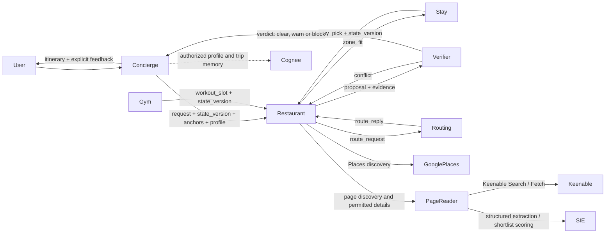

# Restaurant Agent: Final Implementation Plan

Status: implementation target for the Restaurant Agent. This document scopes
the agent and its integration points; it does not claim that the live BAND
workflow or every provider adapter is already implemented.

## Purpose and place in Plan My Stay

The Restaurant Agent finds practical meal options around a traveler's meetings,
stay, and workout schedule. It owns restaurant discovery, meal suitability,
menu evidence, and meal-window replanning. It is a specialist in the shared
Plan My Stay system, not a second trip coordinator.

The Concierge owns the conversation, trip state, traveler profile, and final
itinerary. The Restaurant Agent sends meal proposals to the Concierge and
Verifier, and sends `zone_fit` evidence to Stay so the Stay Agent can consider
the neighborhood's dining options. Stay picks and Gym workout slots can in turn
change the Restaurant Agent's search area or meal windows. The Verifier checks
the final schedule and can return a conflict to the owning agent.

## Contract and ownership boundaries

- Use the common JSON envelope and `handle(message) -> messages` design in
  the team plan (PR #3, `docs/PLAN.md`) as the working target: `schema_version`,
  `type`, `message_id`, `reply_to`, `trip_id`, `state_version`, `from`, `to`,
  `sent_at`, `summary`, and `payload`. The seat names are `concierge`, `stay`,
  `restaurant`, `gym`, `verifier` and `routing`.
- Standardize the BAND seat name and message sender as `restaurant`. Keep the
  existing `workers/food` implementation as an internal module; do not create a
  second external `food.search.v1` protocol.
- Preserve the existing worker contracts `food.replan.v1` and
  `food.results.v1` while adapting them behind the shared envelope. The
  envelope's `state_version` (the version of the trip state a message was built
  on, raised by the Concierge on every change) is the trip revision: map it to
  the worker's `trip_revision` in the adapter, carry it on every proposal and
  `zone_fit`, and discard work built on an older `state_version`.
- Keep BAND as a thin transport wrapper around a locally testable
  `handle(message) -> messages` function. Build and exercise the handler with
  fixtures first. Do not register a remote BAND seat or create a seat key until
  the user's registration hold is lifted and the team confirms the shared
  envelope.
- Reuse the team's shared Keenable/SIE page reader rather than creating a
  Restaurant-only copy. Rohan owns it in the team plan (PR #3); confirm its input,
  output, source citation, and usage-metadata interface before wiring it in.
- Ask the Routing seat for travel times. It is a plain-code BAND seat (owner:
  Mario) that holds the Google Maps key and answers a `route_request` (origin,
  destination, `depart_at`, `modes`) with a `route_reply` (travel minutes per
  mode, or an error). Every lookup is a message round trip, so ask only for the
  shortlisted finalists and the modes a slot needs, and prefilter with
  straight-line distance. The Restaurant Agent never holds the Maps key.
  Straight-line distance is a clearly labelled fallback and must not be
  reported as travel time.
- Cognee is an optional source for authorized, confirmed traveler feedback and
  prior evidence. Do not block discovery on it. Do not write to or read from a
  shared dataset until its key, dataset UUID, and access have been verified.
  Once verified, trace entries go to the trip session starting with
  `agent=restaurant`, as in the team plan. The trip state itself travels in the
  messages; Cognee keeps only a copy.

## Inputs and traveler profile

The Concierge sends only the trip fields the specialist needs:

- Trip ID and `state_version`, city, trip dates, guests, meeting anchors (with
  `counts_for_stay`), supplied `zones`, meal `slots` with date/time windows, the
  `roster`, and the `round` (0 to 2). All times use the trip's one time zone
  (America/New_York for the demo). The stay location arrives in a `stay_pick`.
- Anchors contain location and time window, not meeting title, attendee, or
  private calendar details.
- Traveler preferences in `profile`, with explicit confidence and source: strict dietary
  restrictions/allergies, cuisines, desired meal types, price comfort, walking
  tolerance, and previously accepted or rejected options.
- Search limits and freshness policy for the run (in `constraints`).

Strict dietary restrictions and allergies are hard constraints. Cuisine, vibe,
price comfort, and convenience are ranking preferences unless the traveler
explicitly marks one as mandatory. Recommendations and inferred model output do
not silently become durable profile preferences. Only explicit user feedback
may update the profile, with its source and timestamp retained.

## Discovery, enrichment, and evidence flow

1. **Build search zones.** Use up to three supplied zones around meeting
   anchors, a selected stay, or a workout location. Before a stay is selected,
   meetings remain valid anchors. Do not invent a precise stay location: if the
   picked stay's `location_precision` is `zone`, treat its coordinates as the
   zone's and do not report distances from them as walking distance from the
   stay.
2. **Discover candidates with Google Places.** Pending a team decision (see
   Dependencies and open decisions). For each zone, issue at most one
   nearby search and one preference-oriented text search. Deduplicate on Place
   ID, filter non-restaurant business types, and keep the discovery timestamp,
   query, Place ID, and allowed source fields. Follow current Google Maps
   attribution and storage requirements; only retain durable identifiers or
   fields explicitly permitted by the applicable Places policy.
3. **Find candidate pages with Keenable Search.** Search for the restaurant's
   official site and menu first. Keep every discovered URL and label it as an
   indexed discovery, not proof that its page is current or that the restaurant
   is open. Other sources may be used as corroboration when permitted.
4. **Enrich a bounded shortlist with Keenable Fetch.** Fetch permitted public
   restaurant/menu pages from the shortlist. Preserve page URL, fetch time,
   status, and relevant source spans. A blocked, stale, missing, or non-official
   page is reported as such; do not bypass access controls or scrape
   unauthorized services.
5. **Extract and rank with SIE via the shared reader.** Use the team's selected
   structured extraction model (the team plan, PR #3, uses `Qwen/Qwen3.5-4B`) for menu and
   evidence fields; use a reranker only for bounded soft-preference ranking.
   `fastino/GLiNER2.5-Decide` may be evaluated for narrow classification, but
   does not establish source truth and is not the default structured extractor.
   Benchmark latency and extraction quality on the actual shortlist before
   fixing the model choice.
6. **Validate with deterministic code.** Check hard restrictions, meal time,
   service hours, price limits the traveler marks mandatory (food prices are
   shown but not budgeted in the team plan), zone fit, and evidence freshness. Keep each result tied to its provenance.
7. **Return proposals and zone fit.** Return a ranked set of options with
   evidence, unknowns, source URLs, observed times, and why each option fits.
   Send zone-level dining fit to Stay with the same `state_version`.

### Evidence rules

- Missing, ambiguous, or model-only evidence for a hard dietary requirement is
  `unknown` and does not pass. Never infer allergy safety from cuisine labels.
- A posted menu item or price is evidence from that page at its fetch time, not
  a guarantee the item is still offered or that a meal's total cost is known.
- Published opening hours are not reservation availability. Discovery does not
  confirm a table, current opening status, or live pricing.
- Distinguish `indexed_discovery`, `page_fetched`, `source_supported`, and
  `deterministically_validated` statuses. Do not collapse them into a generic
  “confirmed” label.
- Keep source URLs and quoted/snippet evidence short and tied to the relevant
  candidate field. Do not present unsupported model classifications as facts.

## Message shapes

The Restaurant Agent sends and receives the team plan's messages (PR #3):

- `proposal` (to Concierge and Verifier): `agent`, `items` and `usage`. Each item
  uses the team's item shape: `item_id`, `slot_id`, `name`, `address`,
  `location_precision`, `lat`, `lng`, `when`, `cost`, `fit`, `hours`, `source`,
  `reader` and `dedupe_key`. `hours` uses the keys `Mon` to `Sun` with values
  like `17:00-22:00` (several periods as a list), in the trip's one time zone.
  Evidence statuses, unknowns, and observed times that have no field go in `fit`
  or an extra `evidence` object; receivers ignore payload fields they don't know.
- `zone_fit` (to Stay): `zone_id`, the count of matching restaurants within a
  short walk, and `top_items`.
- `route_request` (to Routing) and `route_reply` (from Routing), as above.
- `error`, or `band_no_reply` when no answer is needed. Every message gets one
  answer.

## Reactive replanning

The handler responds only to events relevant to the Restaurant Agent:

| Incoming message | Restaurant Agent action |
| --- | --- |
| `request` | Discover and propose options for the requested meal slots (`proposal` to Concierge and Verifier); emit `zone_fit` to Stay when Stay is on the `roster`. |
| `stay_pick` | Recalculate zones and travel fit against the picked stay and the new `state_version`; reuse still-fresh candidate evidence. |
| `workout_slot` | Move or narrow the affected meal window and area; re-rank or search only where the current pool is insufficient. |
| `conflict` | Resolve the named restaurant-owned issue, refresh evidence if needed, and post a replacement proposal for the same current `state_version`, carrying the `round` forward. A conflict goes back to its owner at most twice (`round` 0 to 2); after that the Concierge delivers the plan with the open conflict as a warning. |
| `preference_learned` | Use it when re-ranking in the same run. The Concierge decides what becomes a durable preference. |
| stale `state_version` or unrelated message | Answer with an `error` (or `band_no_reply` when no answer is needed); do not launch new searches. |

Replanning should reuse still-valid candidates and evidence rather than repeat
all provider calls. Any derived fact whose anchor, time, or freshness changed is
revalidated. Bound replan cycles by `state_version`, the `round` limit and a per-run call
budget to avoid message loops.

## Initial search budget

The first live version uses a small, explicit ceiling:

- Up to three zones.
- Up to six Google Places searches total: one nearby and one text search per
  zone.
- Deduplicate and select at most six candidates for page enrichment.
- At most one Keenable Search per finalist, and at most two Keenable Fetch calls
  per finalist (official page plus one permitted fallback/corroborating page).
- At most one structured SIE extraction and one shortlist-ranking call per
  finalist; cache results while their source and freshness policy permit.
- If fewer than the configured minimum number of feasible options remain, allow
  one targeted expansion. Record every extra query, fetch, model call, and the
  reason for expansion.

These are initial caps, not a coverage guarantee. The agent reports when a cap
prevents it from returning enough evidence-backed options.

## Observability and result shape

Every run and replan records structured, secret-free telemetry:

- Trip ID and `state_version`, message ID, agent, candidate count, and provider/model name.
- Discovered URLs, source type, fetch status, and source timestamps.
- SIE fields/classifications, model confidence where available, and the
  source spans supporting each extracted field.
- Google Places, Keenable, SIE, routing, and memory request counts, latency,
  usage/credits when exposed, errors, and retry/expansion reason.
- `usage` (`calls` and `credits`) on every proposal. The team's cost ledger (an
  extension) sums it; the ledger is not part of this agent.
- Per-candidate eligibility outcome (`pass`, `fail`, `unknown`), hard-constraint
  reasons, soft ranking factors, and evidence freshness.

Never log API keys, full private profiles, or meeting names/attendees. Errors
must be returned in the structured response and logged with enough context to
debug without leaking secrets.

## Delivery phases and completion checks

| Phase | Deliverable | Completion evidence |
| --- | --- | --- |
| P0: contract and fixtures | Shared-envelope parsing/serialization and pure `handle()` fixtures for request, stay pick, workout slot, conflict (with `round`), route reply, stale `state_version`, and malformed input. | Fixture examples match the team envelope and do not call providers. |
| P1: Places discovery | Three-zone candidate search, type filtering, Place ID deduplication, bounded searches, and `zone_fit`. | Recorded provider counts and fixture/live response mapping with attribution fields handled. |
| P2: page reader and validation | Shared Keenable/SIE adapter, source-linked extraction, deterministic hard checks, freshness, and ranking. | A shortlist shows URLs, source support, unknowns, latency, usage, and errors. |
| P3: reactive planning | Stay/Gym/conflict messages trigger targeted replan while reusing fresh evidence. | A fixture demonstrates recommendations changing after a stay or workout update without repeating all searches. It reproduces the team's demo moment: a workout after meeting B pushes dinner later, a restaurant that closes before dinner ends gets a `conflict`, and the Restaurant Agent replaces it within two rounds. |
| P4: BAND integration | Thin wrapper around the handler and a bounded end-to-end trip in the approved room. | Real messages show zone fit, changed proposal, Verifier conflict and resolution, and usage/latency traces. This phase waits for approved seat registration. |

The end-to-end demonstration is the team's synthetic NYC trip (meetings A, B and C on 17 and 18 Nov in the
team plan) with its meal windows. It must show actual messages, an evidence-backed
proposal, a changed recommendation after a `stay_pick` or `workout_slot`, an
inspectable source URL, deterministic handling of unknown dietary evidence,
and the calls/latency/usage consumed. A live discovery result is never shown as
confirmed availability or pricing.

## Dependencies and open decisions

PR #3's shared envelope, seat roster (including the Routing seat), page-reader
ownership and `state_version` semantics are the agreed working design. PR #4
records the remaining team questions. Before P4, confirm the exact payload
schemas, the shared page-reader API, SIE model latency, that a Routing round
trip is fast enough for the finalists, and the BAND seat-registration plan. Do
not create a competing protocol while those confirmations are pending.

Open between this plan and PR #3:

- **Google Places.** PR #3 says Places isn't needed and that only the Routing
  seat holds the Google Maps key. Decide whether the Restaurant Agent uses
  Places (and with whose key) or finds candidates with Keenable only, as PR #3's
  page reader does. P1 depends on this.
- **Preference learning.** PR #3 lets any agent send `preference_learned`; this
  plan lets only explicit traveler feedback become a durable preference.
  Proposed: the Restaurant Agent sends `preference_learned` with its `evidence`,
  peers use it in the same run, and the Concierge stores only what rests on
  explicit feedback.
- **Routing lookups.** PR #3's `route_request` takes one origin and one
  destination, so six finalists mean six round trips per anchor. Ask the Routing
  owner for a list of destinations.
- **BAND registration.** PR #3's setup registers all six seats; this plan holds
  registration until the user's hold is lifted. Confirm the hold is lifted
  before P4.
- **Cost ledger.** PR #3 gives the cost ledger and lesson writer (extensions) to
  Jwalin or Prathik once their agents work; neither is part of this plan.

Cognee remains deferred until the current tenant/key can access the intended
shared dataset by UUID and authorized profile/feedback behavior is agreed.
Meeting anchors and ephemeral search results need not be written to Cognee to
complete discovery. The user-facing agent must continue to work without Cognee.

## Explicitly out of scope

- Unauthorized Airbnb or other restricted-site scraping.
- Automatic reservations, booking, payment, or claims that a table is available.
- Treating indexed results, model classifications, stale menus, or posted hours
  as live confirmation.
- Replacing the Concierge, Stay, Gym, Verifier, Routing seat, or teammates'
  orchestration work.
- Registering a BAND remote agent before the existing registration hold is
  lifted.
